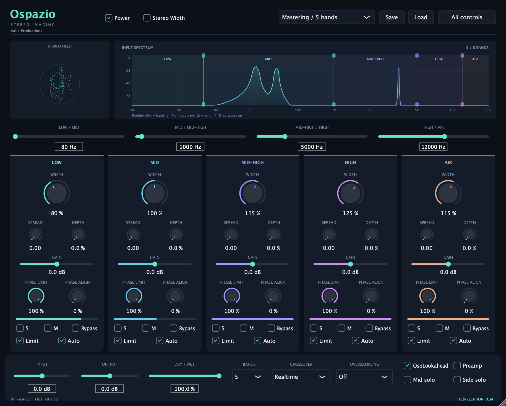

# Ospazio

**Free multiband stereo imaging plugin by Valla Productions.**

Shape where your mix feels focused and where it opens up. Ospazio gives you independent control over stereo width, spread and depth across **up to eight frequency bands**, with visual feedback to help you judge the result.

Keep the low end centred, give synths and pads more space, or widen the top end of a drum bus while keeping its low frequencies focused. Use it on individual tracks, buses or a full mix to shape the stereo image by frequency.

**Version 1.5.0 · VST3 for Windows x64 and macOS Apple Silicon · AU for macOS Apple Silicon**



## Download

Choose the format supported by your DAW:

| System | Format | Download |
| --- | --- | --- |
| Windows x64 | VST3 | [Ospazio-1.5.0-Windows-x64.vst3.zip](https://github.com/vallaproductionsoriginal-byte/Ospazio/releases/download/v1.5.0/Ospazio-1.5.0-Windows-x64.vst3.zip) |
| macOS Apple Silicon | VST3 | [Ospazio-1.5.0-macOS-arm64.vst3.zip](https://github.com/vallaproductionsoriginal-byte/Ospazio/releases/download/v1.5.0/Ospazio-1.5.0-macOS-arm64.vst3.zip) |
| macOS Apple Silicon | Audio Unit (AU) | [Ospazio-1.5.0-macOS-arm64.au.zip](https://github.com/vallaproductionsoriginal-byte/Ospazio/releases/download/v1.5.0/Ospazio-1.5.0-macOS-arm64.au.zip) |

[Release page](https://github.com/vallaproductionsoriginal-byte/Ospazio/releases/tag/v1.5.0)

The three archives contain the **compiled plugins**, with licence notices inside the bundles. This repository distributes the downloads, documentation and licences; **the source code is not published**.

## What it brings to a production

- **A focused low end:** narrow the bass region independently of the rest of the track.
- **More room for musical layers:** widen pads, synths, guitars or backing vocals in the frequency ranges that benefit from it.
- **Space for mono sources:** use Spread to generate stereo differences from the centre signal, then blend the effect to taste.
- **Control over an uneven stereo image:** use Phase Align to reduce left/right energy imbalance within a band.
- **Feedback while you work:** watch the stereo field, correlation meters and frequency-based width display, and check how your decisions translate to mono.

## The main controls

| Control | What you hear or do |
| --- | --- |
| **Width** | Adjusts the Side component in each band. With Spread and Depth at zero, 0% collapses that band to mono, 100% leaves its original width unchanged and values above 100% increase its stereo width. |
| **Spread** | Adds stereo differences using delay, allpass diffusion or a blend of both. Useful for giving a centred sound more space; the advanced controls include a separate Spread mix. |
| **Depth** | Reduces the Mid component and adds diffused Side signal, changing the balance between the centre and the surrounding stereo image. |
| **Gain** | Adjusts the level of each band. |
| **Phase Limit** | With **Limit** enabled, controls how much excess Side energy is reduced: 0% applies no phase correction, 100% applies the full calculated correction. The band's peak limiter remains active at either setting. |
| **Phase Align** | Gradually balances the average left/right energy of a band while preserving stereo timing differences. Works independently of Limit; it does not time-align separate recordings. |
| **Solo / Mute / Bypass** | Isolate, silence or compare the processing of an individual band. |
| **Dry/Wet and input/output gain** | Blend the processed signal and match levels when comparing settings. |

Width changes existing stereo information. For a mono source, use Spread or Depth to create a Side component.

The **All controls** panel exposes, including band links, external sidechain detection, crossover modes, oversampling, preamp saturation and additional Mid/Side monitoring options. Links use the **Low** band's settings as their reference.

## A quick starting workflow

1. Insert Ospazio on a track or bus and choose the number of bands you need.
2. Drag the crossover lines to separate the low end from the ranges you want to open up. **Double-click** the spectrum to split a band; **right double-click** a band to merge it with its neighbour. On macOS, Ctrl + double-click also works for merging.
3. Start with **Width at 100%**, **Spread at 0** and **Depth at 0**. Narrow the lowest band if needed, then increase width in the upper bands in small steps.
4. Add Spread or Depth where the sound needs more space. Use Solo to hear each band's contribution, then judge it again in the full mix.
5. Enable **Limit** and adjust **Phase Limit** where widening needs restraint. Check the correlation meters and audition the result in mono using your DAW's monitoring tools.
6. Match the output level, compare with Power off and use Dry/Wet to settle on the amount of processing.

Six factory presets provide starting points. **Save/Load** writes and reads `.ospreset` files; your DAW also saves the plugin state with the session. Controls support host automation.

### Reading the displays

The spectrum shows the **input after input gain**. Enable **Stereo Width** to see the **output width by frequency**, measured after processing, limiting and Dry/Wet.

The width display reads **0% for mono**, **100% for equal Mid/Side energy** and **200% for Side only**. Pink regions above 100% indicate that Side energy exceeds Mid energy. This is a measurement of the audio, so its percentage is different from the Width knob setting. Hover over the curve to inspect a frequency. Band splitting, merging and crossover dragging work in either view.

Phase Limit helps restrain excessive width, but does not guarantee a minimum correlation for the final mix. Lower amounts can leave negative correlation; full protection can silence a signal that contains only Side and no Mid. The per-band peak limiter does not provide a global true-peak ceiling. Keep checking the complete mix and its mono playback.

### Lookahead and latency

At 48 kHz, latency is **4 ms with Lookahead off** and **9 ms with Lookahead on**. Lookahead gives the limiter detector 5 ms of advance. The plugin reports latency changes to the DAW; compensation depends on the host, and switching Lookahead during playback may cause a brief transient.

## Requirements

| System | Requirements |
| --- | --- |
| Windows | Windows 10/11 x64 and a 64-bit DAW with VST3 support. |
| macOS | An Apple Silicon Mac (arm64), macOS 11.0 or later and a DAW with VST3 or AU support. |

For **Logic Pro**, use **AU**. The Mac builds in this release are for Apple Silicon; an Intel Mac build is not included.

## Installation

1. Download and extract the ZIP for your chosen format.
2. Copy the **entire plugin folder or bundle**, keeping every file inside it, to the location below.
3. Restart your DAW and rescan its plugins.

| Plugin | Folder or bundle to copy | Installation location |
| --- | --- | --- |
| Windows VST3 | `Ospazio.vst3` | `C:\Program Files\Common Files\VST3\` |
| Mac VST3 | `Ospazio.vst3` | `~/Library/Audio/Plug-Ins/VST3/` |
| Mac AU | `Ospazio.component` | `~/Library/Audio/Plug-Ins/Components/` |

On Mac, open **Finder → Go → Go to Folder** and paste the path; create the folder if needed. In Logic Pro, look for **Valla Productions → Ospazio** among the Audio Unit effects and rescan in Plug-in Manager if necessary. The AU bundle keeps its `.component` extension.

On Windows, you can also use a VST3 folder configured in your DAW. Preserve the structure `Ospazio.vst3\Contents\x86_64-win\Ospazio.vst3`. The Visual C++ runtime is linked statically into the plugin.

The Mac bundles use a local ad hoc signature and are not notarised by Apple. The Windows VST3 has no Authenticode signature.

## Download verification

SHA-256 checksums for the packages with licences updated on 15 October 2026:

```text
b16451343efe5c6c9620b0bd16cb94e6cb6f90ff8d1bf64c43368ca9dee8121f  Ospazio-1.5.0-Windows-x64.vst3.zip
3fd6374b9a2b55489b773490d80e56484f34e8b3553e4812088cf0669dc46ea0  Ospazio-1.5.0-macOS-arm64.vst3.zip
1ab3c2c183721356407fb00559c7170f1d1dc09168fee715b810497377dcbc94  Ospazio-1.5.0-macOS-arm64.au.zip
```

On macOS, run `shasum -a 256 archive-name.zip`; on Windows, use `Get-FileHash .\archive-name.zip -Algorithm SHA256` in PowerShell. Replace `archive-name.zip` with the downloaded filename and compare the result with the corresponding line above.

The VST3 plugins extracted from the ZIPs were verified with **453 checks passed on macOS and 453 on Windows x64**, including DSP tests and loading in a VST3 test host. These are the existing release verification results; compatibility also depends on your DAW and its version.

## Licences and dependency notices

Copyright © 2026 Francesco Valla.

- [LICENSE](LICENSE): **PROPRIETARY SOFTWARE LICENSE** for the original Ospazio components and documentation. All rights reserved.
- [NOTICE.md](NOTICE.md): notices for Ospazio, JUCE and other incorporated components.
- [THIRD_PARTY_LICENSES.txt](THIRD_PARTY_LICENSES.txt): dependency licence texts and copyright notices.

JUCE and other dependencies retain their own licences. Notices are also included in each plugin under `Contents/Resources/Licenses/`.

Use of Ospazio requires the copyright holder's express authorisation. Modification, redistribution, sublicensing and sale require prior written permission under the licence terms. Source code is confidential and accessible only to authorised people. Permission requests: [vallaproductionsoriginal@gmail.com](mailto:vallaproductionsoriginal@gmail.com).

## Support

To report a problem, open an [issue](https://github.com/vallaproductionsoriginal-byte/Ospazio/issues) with your operating system, DAW and version, plugin format, sample rate and steps to reproduce it.
